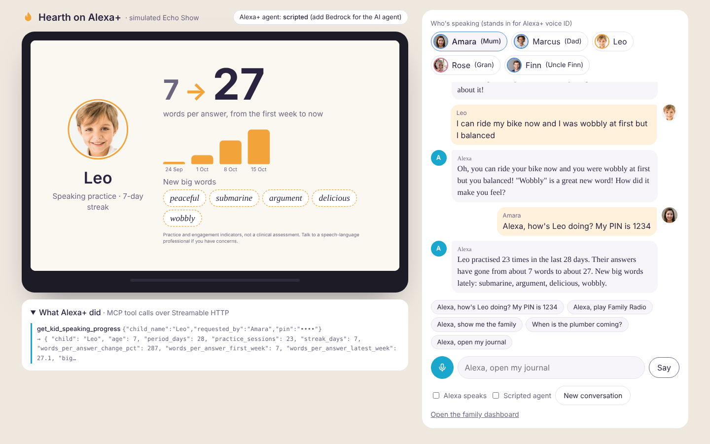

# Hearth — a family memory that talks back

**Alexa+ track · Build, Ship, Shape: Amazon Developer Hackathon 2026**

Gran tells Alexa how she learned to ride her brother's bicycle in 1955. That evening, Alexa asks her grandson Leo about it. He answers in his own words, and Alexa helps him say it more fully. His answer goes back to Gran as tomorrow's question. Mum and Dad watch his sentences grow from "We played. It was fun." to whole stories.

Hearth turns Alexa+ into the family's shared memory: one place where every generation's stories meet. It's built for the one assistant that's already in the room with the whole family.

**Try it in two minutes:** `npm install && npm run seed && npm start`, then open **http://localhost:8787/sim/**: a simulated Alexa+ on an Echo Show. Pick who's speaking, talk (or type), and watch Alexa+ call Hearth's MCP tools and show Hearth's screen.




## What it does

**Family Threads (the heart of it).** Stories travel between people. A grandparent's story becomes a question for the grandchild; the grandchild's answer comes back to the grandparent. Content headed to a child is checked first.

**Everyone talks in their own way.**

| Who | Mode | What Alexa does |
|---|---|---|
| Kids (4–10) | **Speaking practice** | Asks about their day, then *recasts* the answer as a fuller sentence and asks a follow-up — the technique speech educators use. Parents see words per answer grow, and the new "big words" the child starts using. |
| Adults | **Daily log** | A one-minute check-in. Notices patterns ("you've mentioned feeling tired on 4 days this week") and answers "when is the plumber coming?" questions. |
| Grandparents | **Memoir** | One life-story question a day, organised into chapters. |

**Family table.** "Alexa, start a Hearth chat with Gran, Leo and Mum." Alexa hosts a conversation between everyone at the table — often opening with a story that's waiting between two of them — and saves each person's words to their own journal. Leo's turns count toward his practice. Speaker labels come from Alexa+ voice ID; the demo data labels them directly.

**Family Radio.** Every Sunday, a 3-minute spoken episode of the family's week: a highlight for each person, the kids' Word of the Week, a moment from Gran's memoir, and the week's family-table chat.

**Care nudges (opt-in).** If a child mentions a grown-up seems tired or unwell, another grown-up gets a gentle nudge to check in. It never says who mentioned it.


## Privacy and safety

Every rule below is enforced in the server code (`canSee()` in `src/memory.ts`, `src/safety.ts`), so it holds for Alexa and the dashboard alike, however a request is worded.

**Who sees what**

- **Household view** (nobody unlocked): shared grown-up entries only. No children's journals.
- **Each person** sees everything of their own, including private entries.
- **Parents** also see their children's journals and progress.
- **Private entries** ("keep this private"): only the person who said them.
- **Family-table chats**: the people who were there, plus parents.

**A light PIN, because there's no voice ID yet.** Adults can set a 4–6 digit PIN (grandparents and anyone else can skip it). It's only asked for parent-level things: hearing a child's progress, deleting older entries, changing settings, or unlocking the dashboard — once per browser session. Everyday journaling never asks. With Alexa+ voice ID, the PIN goes away. *Demo PIN: `1234`; Gran has no PIN.*

**Consent and deleting**

- A child's profile can only be added by a parent, who hears and agrees to a short consent statement first.
- "Alexa, delete what I just said" deletes the latest entry, no PIN needed within 15 minutes. On the dashboard, each entry has a small Delete link for its author (and for a child's parents).
- Deleting removes the entry, any story threads made from it, and its effect on the speaking-practice numbers.

**How long Hearth keeps things**

| Whose | Kept for | Setting |
|---|---|---|
| Kids' speaking practice | 1 year, then removed automatically | `HEARTH_KEEP_DAYS_CHILD` |
| Adults' daily logs | 1 year | `HEARTH_KEEP_DAYS_ADULT` |
| Grandparents' memoir | Until someone deletes it — it's a memoir | `HEARTH_KEEP_DAYS_ELDER` (0 = keep) |

The dashboard shows the last 7 days in the family view and 12 entries at a time in each journal ("Show older entries" loads more). Expired entries are removed on startup and every 6 hours.

**Safety**

- **Exact words only.** If Alexa hands Hearth a summary ("Leo said he rode his bike"), Hearth refuses it and asks for the child's own words, so the practice numbers stay honest.
- **Possible safety disclosures go to no one in the house.** If someone says something like "someone hurt me and told me not to tell", the entry is kept only for them — not even parents can read it, because the person told could be the person causing harm. It never goes to the AI model or into any thread, and Alexa answers gently, encouraging them to tell a trusted adult (set `HEARTH_SAFETY_RESOURCE` to a local helpline). Thoughts of self-harm get the same care. Trouble with another child at school ("a boy kicked me") stays visible to parents, and Alexa encourages telling them.
- **Care nudges are mild only:** tired, unwell, a headache. Never conflict — words like *shouted* or *angry* never trigger one.
- **Content headed to a child is checked** with Amazon Bedrock Guardrails (`BEDROCK_GUARDRAIL_ID`), or a conservative word filter offline. Anything flagged simply isn't relayed.
- **Not a clinical tool.** Speaking-practice numbers are engagement indicators, and the dashboard says so.

## How it works

```
 Echo / Alexa app ── voice ──▶ Alexa+ ───────────────┐
                                                     │  MCP · Streamable HTTP · spec 2025-11-25
 /sim web app ────── voice ──▶ simulated Alexa+ ─────┤  (tools, plus ui://hearth/screen.html as an MCP App)
                               agent on Bedrock,     │
                               follows SKILL.md      ▼
                                             Hearth MCP server
                                                     │
        ┌──────────────────────┬─────────────────────┼─────────────────────┐
        ▼                      ▼                     ▼                     ▼
 Amazon Bedrock         Bedrock Guardrails     Rules in code        SQLite family store
 summaries · threads ·  checks anything        privacy · safety ·   one instance,
 Family Radio · agent   headed to a child      language metrics     persistent volume
                                                     │
                                                     ▼
                                    Family dashboard (web, live refresh)
```

- **MCP server:** TypeScript, official `@modelcontextprotocol/sdk`, Streamable HTTP at `POST /mcp`, protocol `2025-11-25`. Stateless, one JSON response per request, `Origin` checked, unsupported protocol versions rejected.
- **Fast replies:** Alexa+ expects an answer within about 500 ms, and a model call takes a couple of seconds. So every tool answers straight away from code (the recast, the follow-up, the metrics), and Bedrock writes the richer summary, story threads and care nudges in the background. Family Radio is written ahead of time and cached. A save answers in about 20 ms.
- **Reasoning:** Amazon Bedrock via the Converse API (`src/llm.ts`). With no `BEDROCK_MODEL_ID`, Hearth falls back to templates so it always runs offline. Sensitive entries are never sent to the model.
- **Kids' metrics are computed in code, not by the AI** (`src/language.ts`). The headline is **words per answer**. **"Big words"** are words a child uses for the first time that are uncommon in everyday speech for their age: ranked by SUBTLEX-US spoken-word frequency, three or more syllables or genuinely rare, skipping names and anything echoed from the question. So "played" doesn't count; "germinating" does.

### MCP tools

12 tools. The four marked 🖥 are **MCP Apps** tools: they carry `_meta.ui.resourceUri = ui://hearth/screen.html`, so a screen device shows Hearth's Echo Show screen next to the spoken answer.

| Tool | Used when someone says… |
|---|---|
| `start_journal_session` | "Alexa, open my Hearth journal" |
| `get_journal_prompt` | (Alexa asks today's question — family threads first) |
| `save_journal_entry` 🖥 | (after they answer; returns the recast and follow-up, a pattern, or the memoir chapter) |
| `delete_journal_entry` | "Alexa, delete what I just said" |
| `start_family_conversation` | "Alexa, start a Hearth chat with Gran, Leo and Mum" |
| `save_family_conversation` | (after the chat; one turn per speaker, from voice ID) |
| `get_kid_speaking_progress` 🖥 | "How's Leo's speaking coming along?" (parents, with PIN) |
| `recall_family_memory` | "When is the plumber coming?" · "What did Gran say about the farm?" |
| `play_family_radio` 🖥 | "Alexa, play Family Radio" |
| `show_family` 🖥 | "Alexa, show me the family" · "Is anything waiting for us?" |
| `get_family_threads` | "Is there a story waiting for me?" |
| `manage_family_members` | "Add Mia to Hearth, she's 5" · "Turn on care nudges" |

### Simulated Alexa+ (`/sim`)

The hackathon allows a simulated Alexa+ experience, and Hearth includes one (`src/simulator.ts`, `public/sim/`). It isn't a mock-up of the UI: it's a real agent that reaches Hearth **only through MCP over Streamable HTTP**, the way Alexa+ does.

- **The agent.** With Bedrock on, an Amazon Nova model decides which tools to call (Converse API tool use, with the tool list taken from `tools/list`). Its instructions are Hearth's Agent Skill. Without Bedrock, a scripted router plays Alexa+ so the demo always works offline. You can also switch to it with the "Scripted agent" toggle.
- **Voice ID stand-in.** Choose who's speaking with the photo chips. The speaker is passed to the agent the way Alexa+ voice ID would be.
- **Voice.** The mic uses the browser's speech recognition (Chrome or Edge), and "Alexa speaks" reads replies aloud.
- **The Echo Show screen is a real MCP App host.** The simulator reads `ui://hearth/screen.html` (`text/html;profile=mcp-app`) with `resources/read`, renders it at 1280×800 in a sandboxed iframe, and talks to it with `AppBridge` from `@modelcontextprotocol/ext-apps`.
- **"What Alexa+ did"** shows each MCP tool call and its result, with PINs masked.

### Agent Skill

[`skills/hearth/SKILL.md`](skills/hearth/SKILL.md) is an [Agent Skill](https://agentskills.io) (the open `SKILL.md` format) that teaches any agent how to host Hearth. It covers who's speaking, the journal flow, the exact-words rule, follow-ups for kids, the family table, PINs, safety replies and voice style. The simulator's Bedrock agent loads it as its instructions at startup, and other agents (Claude, or any skills-compatible host connected to Hearth's MCP server) can use it as it is.

## Run it

Requires Node 22.13+.

```bash
npm install
npm run seed        # three weeks of history for the demo family (wipes the database)
npm start           # MCP at /mcp · simulator at http://localhost:8787/sim/ · dashboard at http://localhost:8787/
npm run test:e2e    # 37 checks over real Streamable HTTP (offline, own database)
npm run test:bedrock # 5 checks of the Bedrock paths against a local mock of the Converse API
```

Other scripts: `npm run check:bedrock` (one real Bedrock call to confirm your setup), `npm run lab` (runs sample journal entries through Bedrock so you can read what it writes), `npm run build:ui` (rebuilds the Echo Show screen and the simulator's app bridge after editing `ui/`; the built files are committed).

Open the dashboard, choose **Household view · Unlock**, pick Amara, and enter `1234` to see everything a parent sees. Leave the page open and save an entry through Alexa or the MCP Inspector: it appears on the dashboard within a few seconds.

Inspect the tools with the MCP Inspector: `npx @modelcontextprotocol/inspector`, transport **Streamable HTTP**, URL `http://localhost:8787/mcp`.

### Turn on Amazon Bedrock (optional, and free on the AWS Free plan)

Hearth runs fully without AWS. Bedrock writes the story threads between generations, the summaries and Family Radio, and runs the simulator's Alexa+ agent. Kids' recasts are always instant and written in code, so a child never waits.

1. Create an AWS account and choose the **Free plan** at sign-up (credits, no charges; it closes itself after 6 months).
2. In the Bedrock console, open **API keys → Long-term API keys → Generate**, with a 30-day expiry. Any region that offers Amazon Nova Lite works. Hearth was developed in Asia Pacific (Sydney).
3. Copy `.env.example` to `.env` and paste the key. Keep `.env` private (it's gitignored).

```bash
AWS_REGION=ap-southeast-2              # or us-east-1
BEDROCK_MODEL_ID=amazon.nova-lite-v1:0 # in us-east-1: us.amazon.nova-lite-v1:0
AWS_BEARER_TOKEN_BEDROCK=<your key>
```

4. `npm run check:bedrock`, then `npm start`. The console and `/health` now show `Amazon Bedrock (amazon.nova-lite-v1:0)`, and the simulator's agent runs on Bedrock.

Optionally add `BEDROCK_GUARDRAIL_ID` to check everything read to a child with Bedrock Guardrails. Using Bedrock also qualifies the project for the **AWS Builder Mini Challenge**. The end-to-end tests always run offline.

### Environment

| Variable | Default | Purpose |
|---|---|---|
| `PORT` | `8787` | HTTP port |
| `HEARTH_DB` | `data/hearth.db` | SQLite file |
| `HEARTH_TZ` | `Europe/London` | Time zone for dates |
| `HEARTH_SECRET` | random per start | Signs dashboard sessions. Set it so sessions survive restarts |
| `HEARTH_KEEP_DAYS_CHILD` / `_ADULT` / `_ELDER` | `365` / `365` / `0` | Retention (0 = keep until deleted) |
| `HEARTH_SAFETY_RESOURCE` | unset | A local helpline Alexa can mention, e.g. `Childline on 0800 1111` |
| `HEARTH_CARE_NUDGES` | `off` | Default for care nudges (a parent can turn them on by voice) |
| `BEDROCK_MODEL_ID` | unset | Enables Bedrock reasoning |
| `AWS_BEARER_TOKEN_BEDROCK` | unset | Your Bedrock API key (or use normal AWS credentials) |
| `BEDROCK_GUARDRAIL_ID` / `_VERSION` | unset / `DRAFT` | Bedrock Guardrails for child-bound content |
| `HEARTH_API_KEY` | unset | If set, `/mcp` and `/api` require `Authorization: Bearer <key>` |
| `HEARTH_PUBLIC_URL` | from the request | Public base URL, used for photo links on the screen (set it behind a proxy) |
| `HEARTH_ALLOWED_ORIGINS` | same origin | Extra browser origins allowed to call `/mcp` (comma-separated) |
| `HEARTH_SELF_URL` | `http://127.0.0.1:$PORT/mcp` | Where the simulator's agent reaches Hearth's MCP server |

## Deploy and connect to Alexa+

Hearth keeps the family's journal in one SQLite file, so it needs **one instance with a persistent disk**. Services that wipe the disk on every deploy (AWS App Runner, for example) would lose the family's data.

Good options:

- **AWS Lightsail or a small EC2 instance** running the Docker image, with `/app/data` on the instance's disk.
- **Fly.io or Railway** with a volume mounted at `/app/data`.

```bash
docker build -t hearth .
docker run -d -p 8787:8787 -v hearth-data:/app/data -e HEARTH_SECRET=<random string> hearth
```

Put HTTPS in front (Caddy, a load balancer, or the platform's own). For quick tests, a tunnel works: `cloudflared tunnel --url http://localhost:8787`. The simulator is then at `https://<your-host>/sim/` for judges to try.

To connect a real Alexa+ device instead, onboard with the Alexa AI CLI (see Amazon's *Alexa+ MCP QuickStart Guide*):

```bash
alexa-ai configure
alexa-ai new mcp --name "Hearth" --locale en-US --mcp-server-url "https://<your-host>/mcp"
alexa-ai deploy
```

Re-run `alexa-ai deploy` whenever tool names or descriptions change. Check the QuickStart for the current authentication requirements before deploying publicly.

## Repo map

```
src/server.ts     MCP tools + MCP App resource, HTTP (Streamable HTTP transport, dashboard API, sessions)
src/simulator.ts  simulated Alexa+: Bedrock agent (or scripted router) calling Hearth over MCP
skills/hearth/    the Hearth Agent Skill (SKILL.md)
ui/               the Echo Show screen (MCP App view) and the simulator's host bridge, built by npm run build:ui
src/memory.ts     core logic: visibility rules, entries, threads, conversations, delete/retention, progress, radio
src/safety.ts     paraphrase guard, safety disclosures, care-nudge rules, child-content check (Guardrails)
src/auth.ts       light PIN and dashboard sessions
src/language.ts   language metrics: words per answer, age-graded big words
src/llm.ts        Amazon Bedrock Converse client with offline fallback
src/prompts.ts    question banks, memoir chapters, table openers, per-role style guides
src/db.ts         SQLite schema, migrations and queries
scripts/seed.ts   the demo family's three weeks of history
scripts/e2e.ts    end-to-end MCP test, including the simulator (37 checks)
scripts/bedrock-mock-test.ts  Bedrock paths against a mock Converse API (5 checks)
public/           family dashboard, simulator (public/sim) and built screen (public/ui); photos in public/photos
docs/PLAN.md      build plan, pitch and demo-video script
```

MIT licence. MCP Apps via `@modelcontextprotocol/ext-apps` (MIT). Word frequencies from SUBTLEX-US via the `subtlex-word-frequencies` package (ISC).
