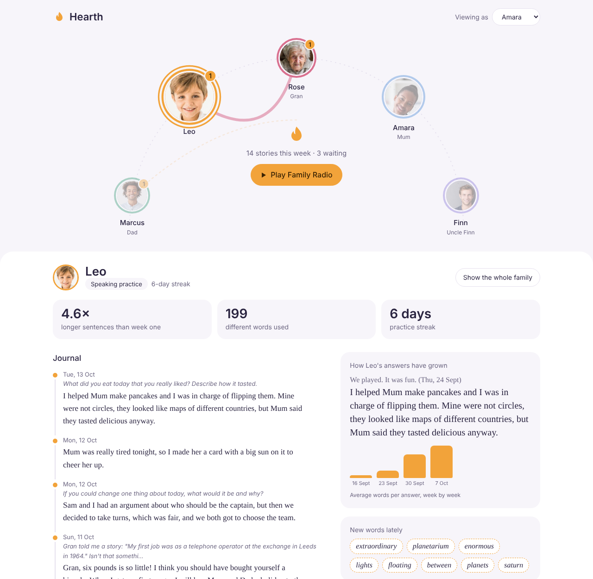

# Hearth — a family memory that talks back

**Alexa+ track · Build, Ship, Shape: Amazon Developer Hackathon 2026**

Hearth turns Alexa+ into the family's shared journal. Everyone in the house talks to it, and it adapts to who's speaking:

| Who | Mode | What Alexa does |
|---|---|---|
| Kids (4–10) | **Speaking practice** | Asks about their day, then *recasts* their answer as a fuller sentence and asks a follow-up — the technique speech educators use. Tracks sentence length, vocabulary and new words for parents. |
| Adults | **Daily log** | A one-minute check-in. Notices patterns ("you've mentioned feeling tired on 4 days this week") and answers "when did I last…?" questions. |
| Grandparents | **Memoir** | One life-story question a day, organised into chapters. |

**The part no single-user journal can do — Family Threads.** Hearth links entries across generations:

- Gran tells Alexa about learning to ride her brother's bicycle in 1955 → that evening, Leo's question is *"Gran told me a story… have you ever done anything like that?"*
- Leo says he can ride without training wheels → Gran's next question is about it.
- Leo mentions Mum looked tired → Dad gets a gentle nudge to check in on her. The nudge never reveals who said what.
- Sunday evening: **Family Radio**, a 3-minute spoken episode of the family's week — a highlight for each person, the kids' Word of the Week, a moment from Gran's memoir.

Alexa+ is the only assistant that's already in the room with the whole family. Hearth is built for that.



The dashboard seats the family on an arc around the hearth. Lines show stories passing between people (dashed ones are care nudges, which never show who triggered them); click someone to open their journal underneath. What each viewer sees follows the same privacy rules as Alexa: only parents can open a child's journal, private entries stay private, and personal patterns are shown only to the person themselves.

> Demo photos are stock placeholders — replace them with licensed or your own photos before publishing.

## How it works

```
 Echo / Alexa app ──voice──▶ Alexa+ ──MCP (Streamable HTTP, spec 2025-11-25)──▶ Hearth MCP server
                                                                                 │
                                         ┌───────────────────────────────────────┼──────────────────────┐
                                         ▼                                       ▼                      ▼
                               Amazon Bedrock (Converse)              Language metrics (code)     SQLite family store
                               summaries · recasts ·                  MLU · vocabulary ·          members · entries ·
                               story bridges · Family Radio           new words                   vocabulary · threads
                                                                                 │
                                                                    Parent dashboard (web) ◀──────┘
```

- **MCP server:** TypeScript, official `@modelcontextprotocol/sdk`, Streamable HTTP transport at `POST /mcp`, protocol `2025-11-25`. Stateless, so it scales horizontally and runs behind any HTTPS host.
- **Reasoning:** Amazon Bedrock via the Converse API (`src/llm.ts`). With no `BEDROCK_MODEL_ID` set, Hearth falls back to templates so it always runs offline.
- **Kid metrics are computed in code, not by the LLM** (`src/language.ts`), so the parent dashboard is reproducible.
- **Privacy rules live in the server, not the prompt** (`canSee()` in `src/memory.ts`): kids' journals are visible only to the child and parents; private entries only to their author; care nudges never name their source.

### MCP tools

| Tool | Used when someone says… |
|---|---|
| `start_journal_session` | "Alexa, open my Hearth journal" |
| `get_journal_prompt` | (Alexa asks today's question — family threads first) |
| `save_journal_entry` | (after they answer; returns the recast, follow-up, pattern or memoir chapter) |
| `get_kid_speaking_progress` | "How's Leo's speaking coming along?" (parents only) |
| `recall_family_memory` | "When is the plumber coming?" · "What did Gran say about the farm?" |
| `play_family_radio` | "Alexa, play Family Radio" |
| `get_family_threads` | "Is there a story waiting for me?" |
| `manage_family_members` | "Add Meera to Hearth, she's 5" |

## Run it

Requires Node 22.13+.

```bash
npm install
npm run seed        # three weeks of history for the demo family (wipes the database)
npm start           # MCP at http://localhost:8787/mcp, dashboard at http://localhost:8787/
npm run test:e2e    # 17 checks over real Streamable HTTP, using its own database
```

Inspect the tools interactively with the MCP Inspector: `npx @modelcontextprotocol/inspector`, transport **Streamable HTTP**, URL `http://localhost:8787/mcp`.

### Turn on Amazon Bedrock

```bash
export AWS_REGION=us-east-1
export BEDROCK_MODEL_ID=us.amazon.nova-lite-v1:0   # any Converse-capable model you have access to
npm start                                          # /health now reports "Amazon Bedrock (...)"
```

Using Bedrock also qualifies the project for the **AWS Builder Mini Challenge**.

### Environment

| Variable | Default | Purpose |
|---|---|---|
| `PORT` | `8787` | HTTP port |
| `HEARTH_DB` | `data/hearth.db` | SQLite file |
| `HEARTH_TZ` | `Asia/Kolkata` | Time zone for dates Alexa says aloud |
| `BEDROCK_MODEL_ID` | unset | Enables Bedrock reasoning |
| `HEARTH_API_KEY` | unset | If set, `/mcp` and `/api` require `Authorization: Bearer <key>` |

## Connect to Alexa+

Alexa+ needs a public HTTPS URL. For development, a tunnel is quickest:

```bash
cloudflared tunnel --url http://localhost:8787     # or: ngrok http 8787
```

For the submission, deploy the included `Dockerfile` (AWS App Runner, Fly.io, Railway or similar all work).

Then onboard with the Alexa AI CLI (see Amazon's *Alexa+ MCP QuickStart Guide*):

```bash
alexa-ai configure
alexa-ai new mcp --name "Hearth" --locale en-US --mcp-server-url "https://<your-host>/mcp"
alexa-ai deploy
```

Re-run `alexa-ai deploy` whenever tool names or descriptions change. Check the QuickStart for the current authentication requirements before deploying publicly.

## Repo map

```
src/server.ts     MCP tool definitions + HTTP (Streamable HTTP transport, dashboard API)
src/memory.ts     core logic: sessions, prompts, entries, threads, privacy, progress, Family Radio
src/language.ts   deterministic language metrics (MLU, vocabulary, new words)
src/llm.ts        Amazon Bedrock Converse client with offline fallback
src/prompts.ts    question banks, memoir chapters, per-role style guides for Alexa
src/db.ts         SQLite schema and queries
scripts/seed.ts   the demo family's three weeks of history
scripts/e2e.ts    end-to-end MCP test
public/           family dashboard (photos in public/photos)
docs/PLAN.md      build plan and demo-video script
```

## Responsible design

- Speaking-practice numbers are engagement indicators, **not a clinical assessment**; the dashboard says so.
- Parents create children's profiles; children's journals are visible only to parents.
- Saying "keep this private" (or `private: true`) keeps an entry out of threads, recall and Family Radio.
- Care nudges never quote or name the person who triggered them.

MIT licence.
